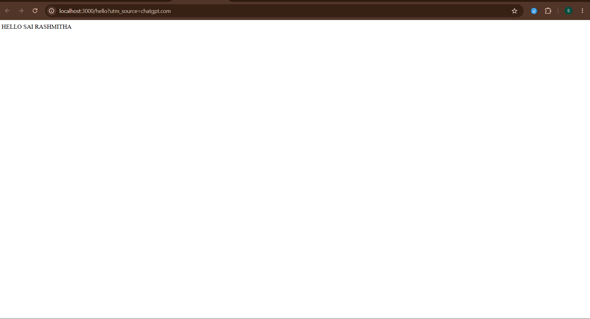
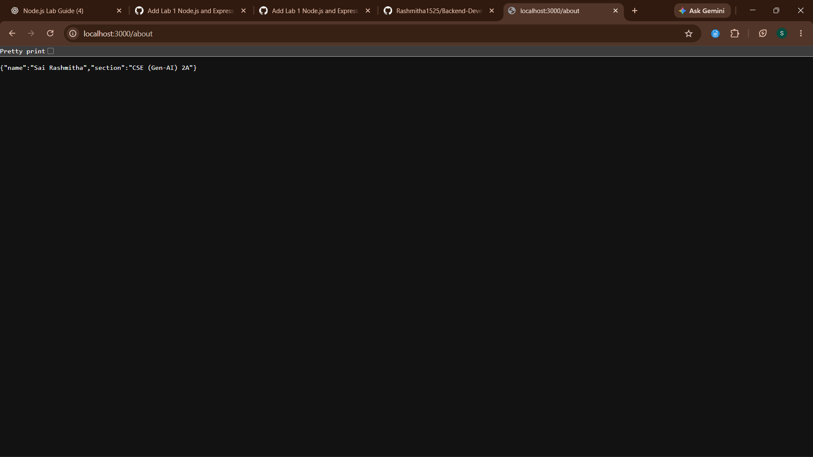
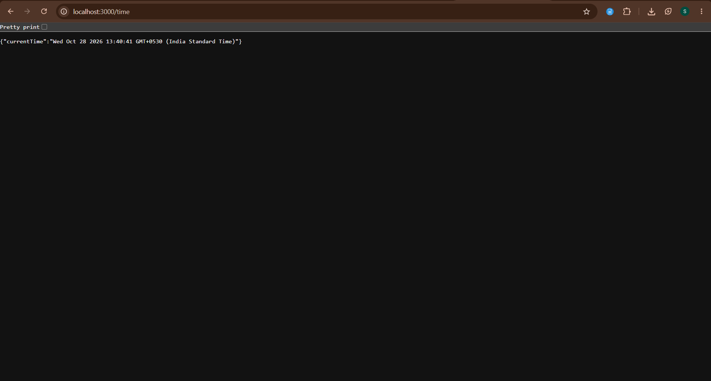

# Lab 1 — Node.js and Express Server

## Student Details

- **Name:** Sai Rashmitha
- **Section:** CSE (Gen-AI) 2A
- **University:** Aurora Deemed to be University
- **Subject:** Backend Development Fundamentals
- **Year / Term:** Year II, Term II
- **Faculty:** Mr. Joel Prashanth D.

## Aim

To create a basic HTTP server using Node.js and build a web server using Express.js with multiple routes and error handling.

## Technologies Used

- Node.js
- Express.js
- JavaScript
- Visual Studio Code
- PowerShell
- Git and GitHub

## GitHub Repository

- **GitHub Profile:** [Rashmitha1525](https://github.com/Rashmitha1525)
- **Project Repository:** [Backend-Development-Labs](https://github.com/Rashmitha1525/Backend-Development-Labs)

## Project Structure

```text
lab-01/
├── server.js
├── app.js
├── package.json
├── package-lock.json
├── .gitignore
├── README.md
└── screenshots/
    ├── home.png
    ├── about.png
    └── time.png
```

## Part 1: Node.js HTTP Server

The `server.js` file uses Node.js's built-in `http` module to create a server on port 3000. It responds with the text `Hello`.

## Part 2: Express Server

The `app.js` file creates an Express server and includes the following routes:

- `/` — Displays the welcome message.
- `/about` — Returns the student's name and section as JSON.
- `/time` — Returns the current date and time as JSON.
- Unknown routes — Return a 404 Page Not Found response.

The application uses `process.env.PORT || 3000` to support deployment platforms that provide a port through an environment variable.

## How to Run

### Prerequisites

Install Node.js and npm on your computer.

### Step 1: Open the Project Folder

Open a terminal in the `lab-01` project folder.

### Step 2: Install Dependencies

Run the following command:

```bash
npm install
```

### Step 3: Run the Node.js HTTP Server

```bash
node server.js
```

Open `http://localhost:3000` in your browser to test the basic Node.js server.

Stop the server by pressing `Ctrl + C` in the terminal.

### Step 4: Run the Express Server

```bash
node app.js
```

Open `http://localhost:3000` in your browser to test the Express application.

Keep the terminal running while testing the routes.

## Testing

The following routes were tested in the browser:

1. **Home Route:** `http://localhost:3000/`
   - Expected status: 200 OK
   - Displays: `Welcome to my Express Server!`

2. **About Route:** `http://localhost:3000/about`
   - Expected status: 200 OK
   - Returns the student's name and section as JSON.

3. **Time Route:** `http://localhost:3000/time`
   - Expected status: 200 OK
   - Returns the current date and time as JSON.

4. **404 Error Route:** `http://localhost:3000/unknown`
   - Expected status: 404 Not Found
   - Displays: `404 - Page Not Found`

## Screenshots

### 1. Hello Sai Rashmitha



### 2. Home Page


### 3. About Page



### 4. Time Page



## Result

The Node.js HTTP server and Express server were created and tested successfully. The Express application supports multiple routes, returns JSON responses for the About and Time routes, and handles unknown routes with a 404 response.